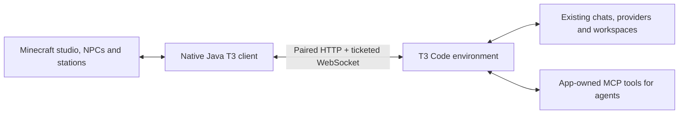

# Native T3 Code integration

Minecraft is the window. Your paired T3 machine is the authority. This guide maps that connection and separates checks we actually ran from work still waiting for a live machine or another operating system.

## Sources and transport

Official repository: **[pingdotgg/t3code](https://github.com/pingdotgg/t3code)**.

Inspected source commit: `250e052f44dd313b658abebc707242a7b25be340`.
Verified running app on 2026-10-05: `0.0.46-nightly.20261005.2667`, orchestration protocol 2.

- [Environment authentication](https://github.com/pingdotgg/t3code/blob/250e052f44dd313b658abebc707242a7b25be340/docs/internals/environment-auth.md)
- [HTTP API contracts](https://github.com/pingdotgg/t3code/blob/250e052f44dd313b658abebc707242a7b25be340/packages/contracts/src/environmentHttp.ts)
- [Orchestration protocol 2](https://github.com/pingdotgg/t3code/blob/250e052f44dd313b658abebc707242a7b25be340/packages/contracts/src/orchestrationV2.ts)
- [Built-in MCP server](https://github.com/pingdotgg/t3code/blob/250e052f44dd313b658abebc707242a7b25be340/docs/orchestration-v2/orchestrator-mcp-server.md)
- [MCP credential middleware](https://github.com/pingdotgg/t3code/blob/250e052f44dd313b658abebc707242a7b25be340/apps/server/src/mcp/McpHttpServer.ts)

The inspected MCP endpoint accepts live provider-session credentials. Those are unsuitable as a durable independent Minecraft login. T3Craft uses T3's paired-client auth and native HTTP/RPC routes instead. This reaches the user's existing conversations directly while allowing T3's agents to continue using the app-owned MCP tools.

The paired Java client is adapted under MIT from [maxwellyoung/t3craft](https://github.com/maxwellyoung/t3craft), commit `56676d33fb24e12ce0ef22cb048753c8c2a78056`. Its separate office, server, world-control MCP and automation features were excluded. [Attribution](../THIRD-PARTY-NOTICES.md) and its license ship in the JAR.

## Architecture

Workflow navigation derives its next action from the owning machine's health, current pending requests and fetched ready checkpoints. The work inbox, chat header and resident controls share `T3Workflow`; they do not create execution state. Setup progress and remembered chat filters are local UI preferences. Resident review poses come from actual ready checkpoints, while command-watching poses require a receipt from the active run. Only two request owners approach the player; additional waiting residents remain at their assigned desks. Pending approvals lock until the exact request is acknowledged or fails, and prepared message retries retain their original model and delivery mode.

Resident typing, mouse pauses, head gestures and nearby thought expressions are derived cosmetic animation. Per-resident timing avoids synchronized hand movement; detected seat/desk geometry places a keyboard and mouse without world writes. Pending requests and machine health take priority over remembered activity. Completion smiles share the existing live-transition guard, so loaded history does not celebrate. Speech remains actual newly completed T3 replies and takes visual priority over thought expressions.

Residents also greet a nearby player, stretch while seated and idle, shift their weight while waiting, point during review and lean while watching commands/tests. Settled residents take staggered lounge breaks with small snack, phone and relaxed developer-idle gestures; these are cosmetic and do not change T3 state. Newly generated modern HQs have eighteen work anchors on the main daylight floor. In older authored saves, `StationAssigner` projects upstairs work assignments onto distinct existing main-floor meeting and lounge seats; it preserves the saved blocks and anchor file. Settled threads retain lounge destinations. These gestures preserve current activity and seat; walking, failures, pending requests, paused work and offline state retain their priority. Client-only walkers check swept body clearance before consuming a path segment. Shared destinations reserve separate positions, and crowded walkers yield, try a checked sidestep, then a retreat around the group. All detour segments must clear both the saved world's floor geometry and other residents. Sealed routes hold on safe ground until space opens.

There is no Node bridge, Foreman runtime, embedded Claude SDK or simulated-chat source. The retained studio snapshot structures are an internal rendering projection of T3 state; they do not perform orchestration.

## Compatibility and release policy

The supported Minecraft target remains 26.3 with Fabric; this change prepares additional targets without claiming support for Minecraft 1.21.x, NeoForge or an untested future version. `mod/gradle.properties` owns the build versions and Java minimum. Resource processing derives the mod's exact Minecraft requirement and minimum Fabric Loader/API/Java requirements from it. The release packager verifies those declarations against the compiled JAR and emits `compatibility.json`, version-labeled archives, a stable Prism ZIP and SHA-256 checksums. Unexpected files, private game/config data, local Java paths and mismatched targets are rejected before release packaging succeeds.

Build/release CI compile, validate the portable package and check paired protocols 1/2 on Windows, macOS and Linux. Windows additionally runs installation/update checks in disposable synthetic profiles. Runtime support and evidence remain separate: CI does not establish native macOS/Linux gameplay, every shader combination, real remote writes or external Git/PR hosts. Add a new Minecraft target only after its Fabric versions, Java requirement, Minecraft hooks, mixins, world recovery and game surfaces are built and checked; older mapped releases may require a separate Loom/source adaptation. Keep T3 wire parsing in `T3Api`/`T3Protocol` and game integration at the client hooks rather than copying workflow logic for each target.

New players import a prebuilt Prism ZIP. The optional Windows release installer verifies the bundled or downloaded package, backs up all saves/mods/config before updating an exact matching Minecraft/Fabric profile, and retains credentials and player settings. First unpaired world entry offers Connections once per session; successful first pairing continues to the existing guide and executes no T3 work. Routine mod updates do not queue a campus rebuild. Development launches resolve the installed native Prism world, while fixture QA explicitly overrides both game directory and pairing config.

The release includes the clean authored save in `release/world-template.zip`, with source-save provenance and file hashes in its adjacent manifest. The explicit closed-world exporter retains authored blocks, signs, terrain, anchors and the saved building plan; player files, entities, inventories, profiles, scheduled events and personal configuration are excluded. Fresh imports load that saved world without regenerating the campus. Existing-instance updates install only managed mods. `--verify-world-source` detects changes after capture, and CI validates the pinned snapshot independently of the author's machine.

## Authentication and history

Pairing exchanges a one-time environment-bootstrap link for a client credential scoped to `orchestration:read orchestration:operate`, plus `terminal:operate review:write` on protocol 2. These additional scopes enable the implemented shell and review RPCs; the issuing grant remains authoritative. Earlier credentials cannot gain scopes automatically: create a fresh link in T3 Settings → Connections and pair the same machine again. The credential is saved in Minecraft's private `config/t3craft.json`. Windows ACLs restrict the configuration to its owner; replacement is atomic. The installer issues a new authorized pairing grant through the installed T3 CLI instead of extracting an existing app session.

The client checks public environment metadata, sends `x-t3-orchestration-protocol: 2`, loads the shell and selected bounded thread projection, and subscribes through a one-time WebSocket ticket. Long-lived access credentials do not appear in socket URLs.

Older history loads through the opaque cursor from the bounded projection and subsequent history pages. History and archived conversations are available through Workspace. Unsent drafts, terminal input and stable chat retry commands live in the private configuration; saved conversation history remains owned by T3. No raw provider transcript directories are consulted.

Protocol 1 compatibility paths are retained from the adapted client and covered by fixtures separately; protocol 2 is the live verified target. T3's rapidly changing client RPC surface is not a guarantee of compatibility with future versions.

The client negotiates the environment's advertised orchestration protocol before pairing and includes that version on authenticated HTTP requests. Optional attachment APIs are capability-gated from the same public environment descriptor: uploads must be advertised, file uploads additionally require `fileAttachments.maxUploadBytes`, and the full draft is checked against those limits before any file is uploaded. This matters during T3's V1-to-V2 transition: a V1 client and V2 server (or the reverse) reject each other, so update every connected T3 environment when changing protocol generations. Missing optional capability fields mean unsupported; the client keeps the draft and reports which machine needs updating.

## Feature coverage

| Feature | Native Minecraft behavior |
| --- | --- |
| Existing chats | All loaded unarchived T3 chats in a scrollable, machine/project-filtered sidebar |
| Saved history | Recent messages and paged older saved timeline; search loaded history and copy latest reply |
| Reliable messaging | Persisted multiline drafts, staged attachments, send lock, acknowledgment before clearing, stable command IDs across explicit retry |
| Explicit New chat | Inherit from the selected chat, or choose a project/model and root/new/existing worktree before native launch |
| Replies during a run | Queue after the exact active run, or explicitly steer it |
| Models/providers | Catalog from the owning machine; model selection on send |
| Stop | Interrupts the selected chat's actual active run |
| Questions | Single/multiple choice, allowed free text, multi-question requests |
| Approvals | Explicit yes/no, revalidated and routed to the exact request |
| Interaction/permission modes | Rename, Chat/Plan and T3 runtime modes |
| Activity | Actual projected command/tool receipts and outcomes |
| Checkpoint review | Ready checkpoint range comparison, file/hunk navigation, feedback to existing chat |
| Notifications | Completion/failure/needs-response HUD, sound and toast |
| Machines | Pair, retry, replace and remove, independent health/routing |
| Appearance | Six pinned T3 built-in palettes in light/dark variants and local custom accent; shared native screens, HUD, monitor/usage text and task-card surfaces |
| NPCs | Eighteen CC0 community-skin defaults; stable per-world desk assignments, adaptive seats/routes, request approach, completion/error effects and reply speech; grouped exact-chat controls for reply/steer/stop, requests, queues, delegation/parent/results, schedules, checkout/review tools, searchable reassignment and pins; current-run receipts select reading/editing/running/testing/review/thinking poses |
| Task wall / board | All loaded chats with independent lane pagination; cards open their exact T3 chat |
| Monitors / terminal | Each resident's bounded messages and receipts; per-world display picker for overview, current status graph, recent chats and native usage/limits; shared chat-status feed and native composer |
| History library | Searchable saved-chat catalog; shelves open the selected chat's history |
| Checkpoint station | Known ready checkpoints on physical cards; exact-chat review and full review catalog |
| Atrium / beacon / lamps | Real studio totals, selected-chat status, per-machine connection health and offline lighting |
| Archived chats / fork / archive controls | Archive/fork in Chat settings; list, read and restore archived conversations in Workspace |
| Reasoning effort and provider-specific options | Select/boolean editors from the owning machine's model descriptors; inherited/unknown options preserved |
| Queue management | Read/edit/cancel queued messages, move a message first, promote to active steering, resume queue |
| Attachments | Stage local files or latest F2 screenshot; signed upload to the draft's own machine on Send |
| Interactive terminal | Dedicated T3 PTY, streaming output, input, Tab, Ctrl+C, detach/reconnect and explicit close |
| Worktrees | List current worktrees; root/new/existing workspace launch; idle-chat handoff with the actual T3 binding updated |
| Delegated tasks | Parent/child status and results; choose from the provider catalog; delegate, open backing chat and cancel app-owned child work |
| Scheduler | List/create/edit, custom weekdays or interval, current/fresh chat destinations, enable/disable, run now and delete |
| Git/PR | Current checkout status; commit/push/create PR; body/review/checks; explicit merge; link and app-owned watch |
| Modern HQ | Glass campus office, eighteen desks across the work floor and upper studios, pixel-art entrance T3 plaque, meeting room, coffee lounge, reception, terrace and reflecting pool |

All advanced controls require protocol 2 and the paired credential's native T3 permissions. GitHub-style PR URLs are supported. The terminal is a bounded text shell view with common ANSI cursor/erase support; full-screen editor/TUI fidelity is not complete. File attachment selection currently uses pasted local paths.

The built-in palette snapshot comes from `packages/shared/src/themePalettes.ts` at the contract revision above (MIT; `licenses/t3code-MIT.txt`). `tools/import-t3-themes.py` converts its OKLCH roles to clamped sRGB in `assets-src/t3-themes.json`; the art pipeline copies and synchronizes that snapshot. Theme selection and accent are local configuration, not T3 server state.

## Verification

On 2026-10-08, the resident movement/gesture pass used the author's latest closed Minecraft 26.3 save, saved at **2026-10-09 01:59:58 UTC** (modern revision 9, 10,837 chunks). `worldTemplateExport` held the world lock and confirmed the source stayed unchanged. The release ZIP was rebuilt from the current 1.1.0 JAR and this cleaned capture; source fingerprint and package validation passed, alongside twelve package regressions and eight Node tests. Fresh installs from this ZIP receive that authored world; existing-instance updates still retain their saves. The native installed mod/profile was not updated or opened in this pass.

The Java 25 build passed office/studio/HQ checks, including bounded/staggered gestures, swept body clearance, two-/four-way crossing arrival, overlap recovery direction, separate floors and sealed-route holding. In an isolated copy of the authored world on Windows, default renderer at 1920×1080, DevBridge 27939 and protocol-2 fixtures 25686/25687, all 18 residents used saved campus positions without regeneration. Actual tick/route QA passed head-on and four-way yielding, stationary bypass, shared-destination reservations, coincident-position recovery and return to assigned desks. The original four-way check first exposed a deadlock; the checked retreat around the group resolved it. Game animation QA passed typing/mouse variation, command/test screen gestures, current activity and request/failure/offline priorities, rendered idle seated stretches, player greetings, preserved seating and greeting expiry. Fixture dispatch counts stayed unchanged. Gesture and separated-resident screenshots were visually inspected; early crowd screenshots were recaptured after correcting an obstructed camera. Evidence is `artifacts/npc-behavior/{crowd-qa,gestures-qa,world-check}.json`, `artifacts/npc-behavior/shots/` and `artifacts/animations/qa.json`.

The updated authored-world spatial check still reports all 116 resident and 13 campus routes reachable, zero crowded anchors and no sampled floor cells below block light 7. Its three misplaced lounge anchors and twenty furniture-climbing routes remain authored-layout findings; this pass preserves that geometry. Native macOS/Linux games, shaders, real remote writes and remote CI were not exercised here.

On 2026-10-08, the 1.1.0 terminal/navigation pass inspected the pinned T3 Code web composer, terminal drawer and terminal/auth contracts. A disposable installed T3 Nightly server on Windows reproduced two real integration failures hidden by the earlier fixture: missing `terminal:operate` pairing scope and successful void RPCs encoded as `null`. Both pairing paths now request terminal/review scopes for protocol 2, and the socket accepts void successes. `check-terminal-live.ps1` passed actual Java pairing and Windows PTY output, checkout, resize, interruption of a sleeping command, detach/reconnect history, explicit restart and close, without dispatching a chat or provider run or changing the active desktop workspace. This proves a local Windows shell path, not remote/provider-specific shells or full-screen TUI fidelity.

The same pass checked the actual Minecraft 26.3 controls in an isolated fresh campus on Windows/Java 25, default renderer at 1920×1080, DevBridge 27929 and protocol-2 fixtures 25686/25687. Terminal and navigation QA passed at GUI scales 2/3/4, including saved input/failure/retry, focus recovery, dimension changes, direct terminal/Ctrl+grave access, History/Back, retained + New composer drafts, + New → Workspace project/model/checkout selection, hidden-field retention and title retention when changing chat mode. Terminal, workspace and tools screenshots were visually inspected. Recovery, workflow, work inbox, 17 menu layouts, NPC and question regressions passed; protocol 1/2 connection/feature and protocol-2 write/workflow checks passed. The Java build passed office/studio/HQ layout checks, eight Node tests and twelve package regressions passed, and all 337 generated resources were current. The portable package was rebuilt from the current JAR and validated; disposable Windows release installation and source updating passed with verified backups and preserved worlds/settings. Source updater QA was rerun successfully with the game closed after an earlier concurrent run stalled. Evidence is `artifacts/release-readiness/terminal.json`, `artifacts/release-readiness/shots/` and the existing fixture QA artifacts. The user's installed Prism profile was not changed in this pass. The authored release world's spatial findings below, native macOS/Linux launches, real remote writes and remote CI remain separate release gates.

On 2026-10-08, a renamed native save titled `T3 HQ` exposed a world-identity bug: `HqWorld.isHq` compared only the editable display name `AgentCraft HQ`, so layout loading and world startup hooks were skipped and NPCs used the row-at-spawn fallback. HQ recognition now also validates the saved `agentcraft-world.json` marker, while rejecting missing, unrelated and malformed markers. The Java 25 build and office/studio/HQ checks passed. An isolated Minecraft 26.3 copy of the clean campus with its title changed to `T3 HQ`, paired only to a loopback protocol-2 fixture, loaded all 139 modern anchors and assigned all six residents to campus stations; none used the spawn fallback. The 1920×1080 screenshot was visually inspected. Evidence is `artifacts/qa/world-identity/qa.json` and the isolated game's local `agentcraft-shots/renamed-hq-residents.png`. No command was dispatched to a real T3 environment. The native Prism profile was then updated through its verified backup flow: all 55 saved-world files matched their backup, the installed JAR matched the build, and pairing, options and layout hashes were unchanged. Its relaunch reached the Minecraft render window and initialized the mod; the world was not opened during this update check.

On 2026-10-08, the source updater's Windows PowerShell 5.1 ZIP failure was reproduced with only the FileSystem compression assembly loaded. Explicit loading of both compression assemblies passed a fresh-process `check-source-update.py` run through the actual `update-hq.ps1 → install.ps1 → prism.ps1` chain, including the Java 25 build, ZIP creation, verified world/mod backups and current installed hashes. The disposable profile's world, pairing, options, shaders and custom instance settings retained their hashes, and no world rebuild was queued. Only the Fabric API network download was replaced with a hash-checked cached package JAR. The user's installed profile was not updated by this check.

On 2026-10-08, the clean release-template pass exported the author's latest saved Minecraft 26.3 campus (saved at 13:47:50 UTC, modern layout revision 9) without changing the native source. The Java 25 build passed office/studio/HQ checks and nested NBT privacy regressions; twelve release-package regressions and disposable Windows fresh-install/update recovery checks passed. Package validation verifies every approved world file and rejects private paths, corruption and stale source captures. An isolated fresh copy loaded in Minecraft 26.3 without pairing credentials or campus regeneration; exterior and interior screenshots were visually inspected with the default renderer at 1920×1080. All 116 resident routes and 13 campus routes were reachable, with no crowded anchors or covered cells below block light 7. The authored save still has three misplaced lounge anchors and twenty routes that step over furniture; these remain final spatial-polish findings, not a clean geometry result. Evidence is `artifacts/release-world/qa.json` and `artifacts/release-world/shots/`. Existing-instance updates retain their worlds, and this pass did not install into the native profile. Other operating systems, shaders and remote CI were not exercised in this pass.

On 2026-10-08, the resident animation pass passed the 1.1.0 Java 25 build, including office/studio/HQ layout checks and bounded hand-motion/expression regressions. Isolated Windows Minecraft 26.3 game QA with protocol-2 fixtures on 25686/25687 and DevBridge 27919 verified typing bursts, mouse pauses, rendered hand-channel variation, activity-specific postures, completion reaction expiry, request/failure/offline priorities, and zero dispatched T3 commands. The keyboard, thought icons and gestures were visually inspected at 1920×1080 with the default renderer. Evidence is `artifacts/animations/qa.json` and `artifacts/animations/shots/`. This animation build has not been installed into the user's Prism profile or checked with shaders or on other operating systems.

On 2026-10-08, the 1.1.0 installation/compatibility pass passed the Java 25 build (including office, studio and HQ layout checks), protocol 1/2 fixture workflows, seven release-package regressions, and disposable Windows installation/update checks. Isolated Minecraft 26.3 onboarding passed at GUI scales 2/3/4: first unpaired entry offered Connections, dismissal stayed dismissed for the session, and fixture pairing opened the guide without dispatching T3 commands. Evidence is `artifacts/qa/installation/onboarding.json`. The verified portable package was then installed into the user's existing `T3Craft-26.3-Native` Prism profile after a hash-verified backup of all saves, mods and config. Pairing config, player options, instance settings and the current HQ world file retained their hashes before launch. The native log confirmed T3Craft 1.1.0 and loading the existing `AgentCraft HQ` world. Evidence is `artifacts/qa/installation/native-install.json`. The game remains open for the user. This does not establish native macOS/Linux launches, shader compatibility, additional Minecraft versions or real remote write behavior; CI changes have not yet run remotely.

On 2026-10-07, the visual pass was checked with the local 1.0.0 working-tree build in an isolated Windows Minecraft 26.3 client, Java 25 and protocol-2 fixtures on 25686/25687, with DevBridge 27899 and the default renderer at 1920×1080. All ten current campus/native-screen views captured successfully and were visually inspected. Review/library checks passed at GUI scales 2/3/4, including file-row clicks, deleted-file selection and change navigation. The eighteen-resident check passed chair relocation/rotation/obstruction recovery, close labels and display bounds. The build passed office/studio/HQ layout checks, including the regression distinguishing pending requests from failure cards, and generated asset sync was current. The pass reduced resident-label crowding, resized/raised the atrium dashboard and corrected its reservation geometry, separated waiting-card styling from errors, and added machine context to the library. Evidence is `artifacts/qa/visual-pass/final-manifest.json`, `artifacts/qa/t3-residents.json` and `artifacts/shots/visual-pass/`. Captures use synthetic activity and dispatch no T3 commands. This visual build has not been installed in the user's Prism profile or checked with shaders or on other operating systems.

On 2026-10-07, the workflow navigation and resident presentation changes passed isolated Windows Java 25/Minecraft 26.3 protocol-2 game QA at GUI scales 2/3/4. The direct tools grid and Minecraft title branding were also checked in the isolated client; tool navigation passed incremental search, retained result filtering on Back, Escape return, and bounds at GUI scales 2/3/4 (`t3-navigation-qa.mjs`). Checks covered guide/work/chat/tool layouts, search focus across result rebuilds, pagination reset, retained chat filters, Ctrl+Tab switching, exact-request/review/offline actions, command-watching and ready-review poses, failure priority over older checkpoints, and at most two approaching request owners. NPC workflow and question regressions passed separately. The Java build passed office/studio/HQ layout checks, including workflow action priorities and status/desk/recent filtering; disposable protocol 1/2 connection/feature checks and protocol-2 write/workflow checks passed. Evidence is `artifacts/qa/t3-flow.json`, `artifacts/qa/t3-npc.json`, `artifacts/qa/t3-questions.json` and `artifacts/qa/flow-shots/`. On the same date, the primary navigation and recovery follow-up passed `t3-navigation-qa.mjs`, `t3-recovery-qa.mjs`, `t3-workflow-qa.mjs`, `t3-flow-qa.mjs` and `t3-npc-qa.mjs` in a freshly generated isolated HQ. The workflow check uses the current route count; the HQ inspector compares route height against both endpoint floors and seat spacing in three dimensions for the three-floor campus. Protocol 1/2 fixture connection and feature checks and protocol-2 write/workflow checks passed. The mod was installed through `update-hq.ps1 -ModOnly`, after hash-verifying the complete HQ and old-JAR backups. Native Windows Prism launch and navigation/recovery checks passed at 1920×1080 and GUI scales 2/3/4 with Iris/Sodium and Complementary Reimagined r5.9.3 enabled. Installed checks used synthetic pairing, and the original launcher and game options were restored byte-for-byte afterward. Evidence is also in `artifacts/qa/navigation-shots/` and `artifacts/qa/installed-profile/shots/`. Real remote writes and other operating systems remain unverified.

On 2026-10-06, the grouped NPC controls passed isolated Windows protocol-2 game QA at GUI scales 2/3/4: exact-owner approvals, queued reply and steering receipts, native workflow destinations, schedule and delegation context, reading/editing/testing/reviewing/thinking postures, stop, reassignment and unpinning. Question QA passed choices, multiple questions, free text, failed-send retry and withdrawal. Evidence is `artifacts/qa/t3-npc.json`, `artifacts/qa/t3-questions.json` and `artifacts/qa/npc-game/agentcraft-shots/`. Java 25 build and disposable protocol 1/2 connection/features plus protocol-2 write/workflow checks passed. This is synthetic development-world evidence; these NPC changes have not been installed in the user's real profile.

On 2026-10-06, the Windows Java 25/Minecraft 26.3 build passed `officeCheck`, `studioCheck` and `hqLayoutCheck`, including all eighteen real desk/lounge chairs and their bidirectional routes. The art pipeline validated twenty-four skins (eighteen gaming looks plus retained compatibility assets) and all resources, reproduced identical output across three hash seeds, and `sync.py --check` passed. Earlier protocol checks on this date passed protocol 1/2 connection/features and protocol-2 writes/workflows through `python tools/check-workflows.py`, plus all eight Node tool tests.

The expanded cast passed isolated protocol-2 game QA: eighteen distinct gaming textures, Yoshi/Mega Man, nearby chair movement/rotation, obstruction and restoration, close nameplates, saved display choices and menu bounds at GUI scales 2/3/4. Polish QA verified all twelve palette variants, gaming look switching, saved accents and twenty native screen layouts. Studio QA passed own-desk typing, exact waiting requests, completion/error effects, speech, per-machine offline recovery and native station routing. A further game check walked an additional resident up to its upper-floor desk and back downstairs to a seated lounge pose. Shader-enabled screenshots confirmed close nameplates, readable task-wall text and the themed status graph; the task-wall canvas and card bodies use separate deferred geometry buffers. Evidence is in ignored `artifacts/qa/t3-{residents,polish,studio,upper-resident}.json` and `artifacts/shots/`. These checks used synthetic pairings and the isolated development world; the expanded build has not been installed or relaunched in the user's real profile.

On 2026-10-09, the eighteen selectable skin textures were replaced with eighteen selections from isaiah658's CC0 Minetest Skins Pack 1. The source pack uses the legacy 64x32 layout; the asset generator maps it to modern 64x64 textures and mirrors the missing left limbs. Generation and resource sync completed, and `sync.py --check` found no stale files. The new looks and portraits have not been checked in a running game.

An additional isolated block-edit check placed a two-block obstacle in a resident's active route, verified it could not pass through the new wall, and observed recovery at its desk after removal (`artifacts/qa/t3-block-route.json`). Earlier menu/question QA covered chat search, waiting-question typing isolation, obstruction rejection, paged HQ visits, choices, multiple questions, free text, failed-send retry and withdrawal (`artifacts/qa/t3-{menus,questions}.json`). Theme selection remains local; these results do not establish the user's installed shader-pack behavior.

The roadmap implementation was checked on Windows on 2026-10-05. Build, protocol 1/2 connection and feature regressions, office/studio projections, explicit write checks, fault-injected workflow checks and all eight screenshot-tool tests passed. CI now runs the disposable fixture checks on Windows, macOS and Linux.

Fixture-backed Minecraft QA drove the actual worktree handoff, model options, custom-weekday schedule edits, Git/PR actions and linking, queue edit/reorder/steer/cancel, delegated task cancellation, terminal input, and new-worktree launch screens. The modern HQ has 68 checked reachable routes, zero furniture-climbing/crowded/misplaced routes or slots, and zero covered cells below block light 7. These checks use synthetic data: advanced write controls have not been exercised against real remote T3 machines or real Git/PR hosts. macOS/Linux game launches remain unverified.

The following notes describe earlier chat/review verification and the original studio layout:

Plain-JVM checks exercise the production Java paired client against two isolated loopback fixtures. They cover identity/owner routing, stale requests, reconnects, protocol negotiation, pairing exchange, model changes, existing-chat replies, explicit creation, settings and checkpoint diffs. Write checks run only against fixtures.

The live probe reads the real paired T3 environment and verifies the socket subscription and provider catalog, without creating chats or sending messages. Minecraft development-client QA verified the native panel with 150 existing chats and six HQ residents. Isolated in-game checks verified own-desk typing, exact-request waiting approach, completion particles, return to the lounge, failure, offline lights, a healthy peer machine, recovery and native station screens. The HQ check found 68 reachable routes and no NPC path failures; it still reports six routes that step over furniture in the original layout.

`studioCheck` covers the full-history task/library/feed projection, per-desk content, absent bindings, offline provenance and speech replay suppression. `officeCheck` covers the global eighteen-desk capacity across machines and persisted slot identity. The snapshot regression verifies that pending request details load even with every panel closed. Write checks run against fixtures only.

The native Prism instance now launches successfully. Its log confirms the generated HQ and all six residents, and the user's screenshot shows the connected T3 task wall. That startup recorded Marlow teleporting after failed paths; the earlier zero-failure result applies to the isolated development scenario and does not establish every native navigation route. The wall update keeps the complete loaded chat catalog on independently paged, full-size cards with T3 status labels and project context.

Read-only wall QA in the development game retained all 150 real chats and traversed the 149 idle chats across 50 physical pages through actual use-key clicks. It verified both navigation boundaries, Previous, full-size cards and native card opening. The build and plain-JVM pagination checks passed; the portable ZIP matches that build and contains no pairing/account configuration or fixed Java path. After the user closed Minecraft, the wall build was installed into the native Prism instance. Its installed JAR matched the verified build, and the private T3 configuration hash was unchanged. The 2026-10-08 native 1.1.0 relaunch above supersedes the pending launch check; physical wall interaction in the user's profile remains unverified.

See [developer commands](../tools/README.md) and [the user guide](USER-GUIDE.md).

On 2026-10-13, the 1.0.1 release preparation captured the latest closed native world saved at **2026-10-13 08:38:29 UTC**, modern revision 9, **11,055 chunks**. The exporter held the world lock and left its source unchanged. Fresh imports and standalone Windows installations receive this cleaned authored snapshot; existing-instance updates preserve their worlds. The standalone installer now includes the matching Prism ZIP and checksum manifest, so it does not depend on a previously published release to install this candidate.

The shared T3 menu scale now preserves the saved Minecraft GUI preference while using a 960×540 canvas at 1080p with settings 2/3/4. Native screen initialization, rendering, input and resize all use the same scale; closing the menu restores the world scale. The sidebar uses Search/New at the top, hidden scope controls, separate Working and Settled shelves, independent scrolling and visible selected-thread context. Settled uses the owning T3 thread's explicit settled fields rather than treating every completed run as settled. Native fixture clicks verify exact thread routing and retained Back navigation without dispatching T3 work.

The final Java 25 build passed office/studio/HQ checks, including distinct main-floor assignments against the actual exported campus and visible lounge arm-motion regressions. Isolated Minecraft 26.3 checks passed the seventeen-menu/navigation suite, all twelve theme variants, eighteen community looks, shelf clicks/scale restoration, typing and rendered snack/phone/idle gestures, and eighteen-resident crossing/spacing/recovery scenarios. Screenshots of the compact sidebar, thread nameplates, typing and phone gesture were visually inspected at 1920×1080 with the default renderer. Protocol 1/2 connection/feature checks and protocol-2 writes/workflows passed on disposable fixtures. All 337 generated resources were current; twelve package regressions and eight Node tests passed. Windows installation/recovery checks passed both the published-feed fixture path and the self-contained installer, including the exact authored world and corruption refusal. Evidence is `artifacts/qa/t3-sidebar.json`, `artifacts/qa/t3-polish.json`, `artifacts/qa/t3-menus.json`, `artifacts/animations/qa.json`, `artifacts/npc-behavior/crowd-qa.json` and `artifacts/release-1.0.1/`.

The native Prism profile then received 1.0.1 through the mod-only updater and its verified backup flow. All 55 saved-world files retained their hashes; pairing configuration and player options were unchanged, and the installed JAR matched the release package. No campus rebuild was queued. Its relaunch initialized 1.0.1 and loaded modern revision 9 with all 139 saved anchors. Native macOS/Linux gameplay, additional shader combinations, real remote writes and remote CI remain separate from these local results.
